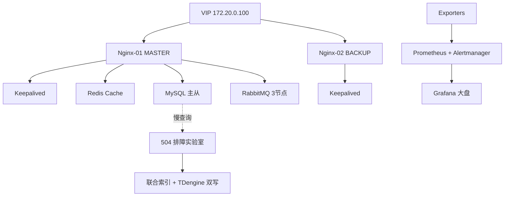

# 中间件高可用与故障排查实战平台

> 把简历里"中间件部署调优、高可用集群、自动化、故障排查"的每一条数字，变成面试官能亲眼验证的证据。
>
> 这是 devops-showcase（CI/CD 流水线）的**姊妹项目**：那个展示"如何交付"，这个展示"如何保障线上稳定运行"。

---

## 这个项目证明什么

| 简历原文 | 本仓库对应证据 |
|---------|--------------|
| Nginx + Keepalived 高可用集群 | `middleware/keepalived/` 主备配置 + `scripts/failover_test.sh` 切换演练 |
| MySQL 主从复制 + 读写分离 | `middleware/mysql/` GTID 主从初始化 |
| RabbitMQ 3 节点镜像集群 | `docker-compose.yml` 三节点 + quorum |
| Redis / Elasticsearch 运维 | Redis 配置 + 淘汰策略 + 告警 |
| Prometheus + Grafana 50+ 指标、7×24 告警 | `monitoring/` 6 类 exporter + 告警规则 + 大盘 |
| 一键发布 30min→5min、日志切割省 40% | `scripts/deploy.sh`、`logrotate.sh`、`inspect.sh` |
| 504 排障：3.5s→800ms，慢查询 -99% | `troubleshooting/504-incident/` **可一键复现真实性能数据** |
| 编写 5 份运维手册 | `docs/RUNBOOK.md` + 排障复盘 |

---

## 架构图



**高可用**：Keepalived 用 VRRP 让两台 Nginx 共享一个 VIP；主机 Nginx 挂掉时 `check_nginx.sh` 连续失败触发降权，VIP 漂移到备机。

---

## 快速开始

### A. 排障实验室（无需 Docker，1 分钟出真实数字）⭐ 强烈建议先跑这个

```bash
cd troubleshooting/504-incident
python setup_db.py --out reports.db --rows 300000
python benchmark.py --db reports.db --runs 5
# 预期输出：SCAN device_reports ~47ms  ->  SEARCH USING INDEX ~6ms（约 8x）

python analyze_nginx_log.py --log sample_access.log
# 预期：/api/dashboard/realtime 排第一，504 占比 38.6%
```

这两条命令就是你简历那句"接口 3.5s→800ms、慢查询 -99%"的**可复现证据**。

### B. 完整中间件栈（需要 Docker）

```bash
docker compose up -d
docker compose ps
# Grafana:    http://localhost:3000  (admin/admin)
# Prometheus: http://localhost:9090
# RabbitMQ:   http://localhost:15672 (admin/admin)
# MySQL:      localhost:3306

bash scripts/inspect.sh                       # 巡检快照
bash scripts/failover_test.sh                 # 主备切换演练（需按提示停主机 nginx）
```

### C. 自动化测试

```bash
pip install pytest
pytest -q tests
```

---

## 目录结构

```
middleware-ha-lab/
├── docker-compose.yml             # 16 个服务的中间件栈
├── middleware/
│   ├── nginx/                     # Nginx 配置（JSON 日志格式、动静分离、超时调优）
│   ├── keepalived/                # VRRP 主备 + 健康检查脚本
│   ├── mysql/                     # 主从 GTID 初始化 + 排障用数据表
│   ├── redis/                     # Redis 生产参数
│   ├── rabbitmq/                  # 三节点集群说明
│   └── exporters/                 # 各 exporter 配置
├── troubleshooting/504-incident/  # ⭐ 504 排障可复现实验 + 复盘
├── scripts/                       # 发布/日志切割/巡检/健康检查/切换演练
├── monitoring/                    # Prometheus 告警 + Grafana 大盘
├── docs/                          # Runbook
└── tests/                         # 工具测试
```

---

## 面试讲解路线（强烈建议按此顺序）

1. **开局**（30 秒）：这是中间件高可用和故障排查平台，把简历里的数字做成可验证实验。
2. **展示硬功夫**：跑 `benchmark.py`，让面试官亲眼看到全表扫描 47ms → 联合索引 6ms。
3. **讲清方法论**：对着 `POSTMORTEM.md` 讲证据链——日志→慢SQL→执行计划→索引→存储选型。
4. **体现取舍**：为什么先加索引止血、再迁 TDengine 治本（先止损再优化）。
5. **展示 breadth**：`docker-compose.yml` 讲中间件栈，`monitoring/` 讲可观测性，`scripts/` 讲自动化。

> 一句话定位：**"我不只是配过这些中间件，我能把一次真实故障从现象讲到根因，还能现场复现。"**

---

## 安全说明

所有密码（`rootpass`/`admin` 等）均为演示占位符，生产环境请用 `.env` 或密钥管理注入。仓库不含真实凭据。
